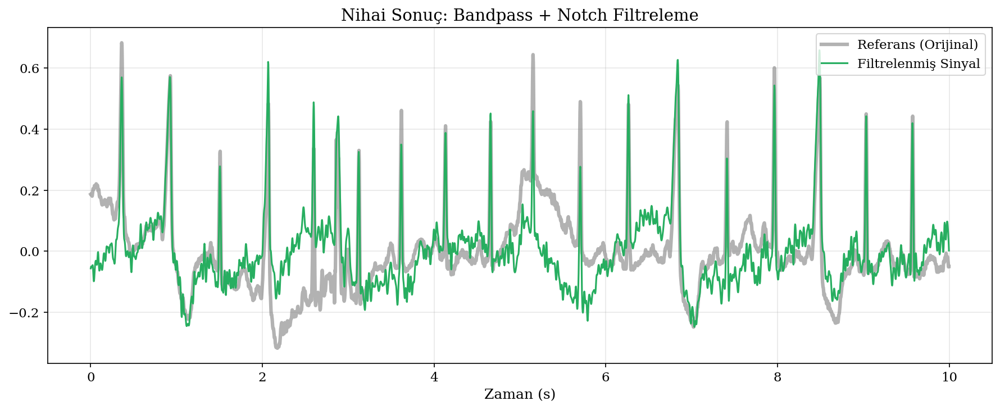

# Biomedical ECG Signal Processing

Study how simulated interference affects an ECG waveform and how digital filters change signal quality and peak detection.

The executable pipeline loads a segment of SciPy's example ECG, adds reproducible noise, applies notch and band-pass filters, and writes plots and summary measurements. This is a signal-processing experiment, not a clinically validated detector.

## Key Features

- Seeded 50 Hz powerline interference, 0.5 Hz baseline drift, and Gaussian sensor noise.
- A 50 Hz IIR notch followed by a fourth-order 0.5–40 Hz Butterworth band-pass filter.
- Peak detection and one-to-one tolerance matching of detected and reference peaks.
- Signal-to-noise ratio, time/frequency plots, spectrograms, and confusion matrices.
- Headless chart export for reproducible command-line execution.

## Tech Stack

Python, NumPy, SciPy, Pooch, Matplotlib, Seaborn, and scikit-learn. SciPy 1.10+ provides the dataset API; Pooch downloads the example data. See [requirements.txt](requirements.txt).

## Architecture & Project Structure

```text
.
├── main.py                                # Data, filters, peak matching, plots
├── Biomedical_Ecg_Signal_Processing.ipynb   # Notebook experiment
├── Graphics/                              # Committed examples and generated results
├── tests/                                 # Filter and peak-matching regressions
├── requirements.txt
└── LICENSE
```

`main.py` processes seconds 17–27 at 360 Hz, normalizes the segment, injects noise with seed 42, and evaluates noisy and filtered signals. Reference peaks come from the original example waveform using the same detector; they are not independent clinical annotations. Sample-level true negatives dominate the confusion matrix, so overall accuracy alone would be misleading.

## Getting Started

Use Python 3.11. The first dataset load requires internet access; later runs can use SciPy's local cache.

```bash
git clone https://github.com/MustafArikan/Biomedical-Ecg-Signal-Processing.git
cd Biomedical-Ecg-Signal-Processing
python -m venv .venv
```

Activate with `source .venv/bin/activate` on Linux/macOS or `.venv\Scripts\Activate.ps1` in PowerShell.

```bash
python -m pip install -r requirements.txt
```

## Configuration

No credentials or environment variables are required. Run from the repository root. `OUT` in `main.py` selects the output directory; filter frequencies, detector thresholds, and the 18-sample matching tolerance are defined in the source.

## Usage

```bash
python main.py
```

The command writes nine figures and `Graphics/results.txt`, overwriting previous outputs. Matplotlib uses the noninteractive `Agg` backend.



The notebook can be opened separately after installing Jupyter; it is an experimental companion and is not automatically synchronized with the script.

## Testing

```bash
python -m unittest discover -s tests
```

Tests verify one-to-one peak matching, 50 Hz rejection with pass-band preservation, and segment length/normalization. Dataset loading is replaced with a deterministic array in the unit test; the actual pipeline run separately exercises dataset retrieval and chart export.

## Development & Quality

```bash
python -m compileall -q main.py tests
python -m pip check
```

No CI workflow or packaged application build is configured. Review numerical changes together with regenerated outputs; do not treat committed charts as measurements of changed code.

## Roadmap

- Evaluate peak detection against independently annotated records.
- Report beat-level precision and recall alongside sample-level matrices.
- Consolidate the notebook and script around shared processing functions.

## Contributing

Include the sampling rate, signal source, noise seed, filter settings, and validation results when proposing numerical changes. Run the tests and pipeline before updating result artifacts.

## License

Code is distributed under the [MIT License](LICENSE). The SciPy example dataset has its own provenance; consult SciPy's dataset documentation for reuse.

## Author

[Mustafa Arıkan](https://github.com/MustafArikan)
